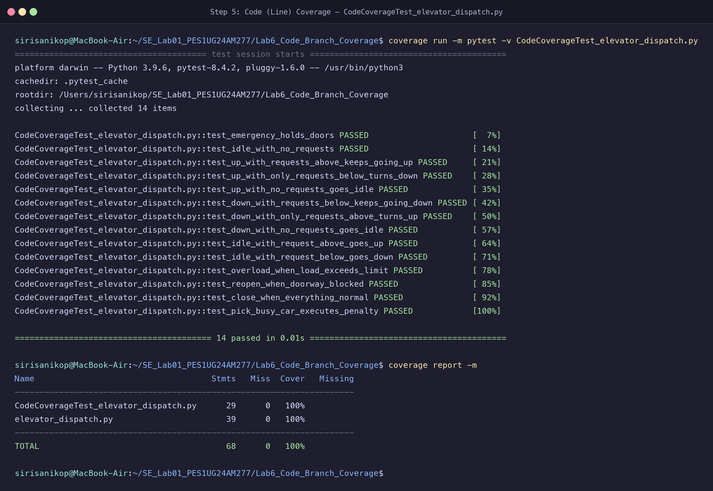
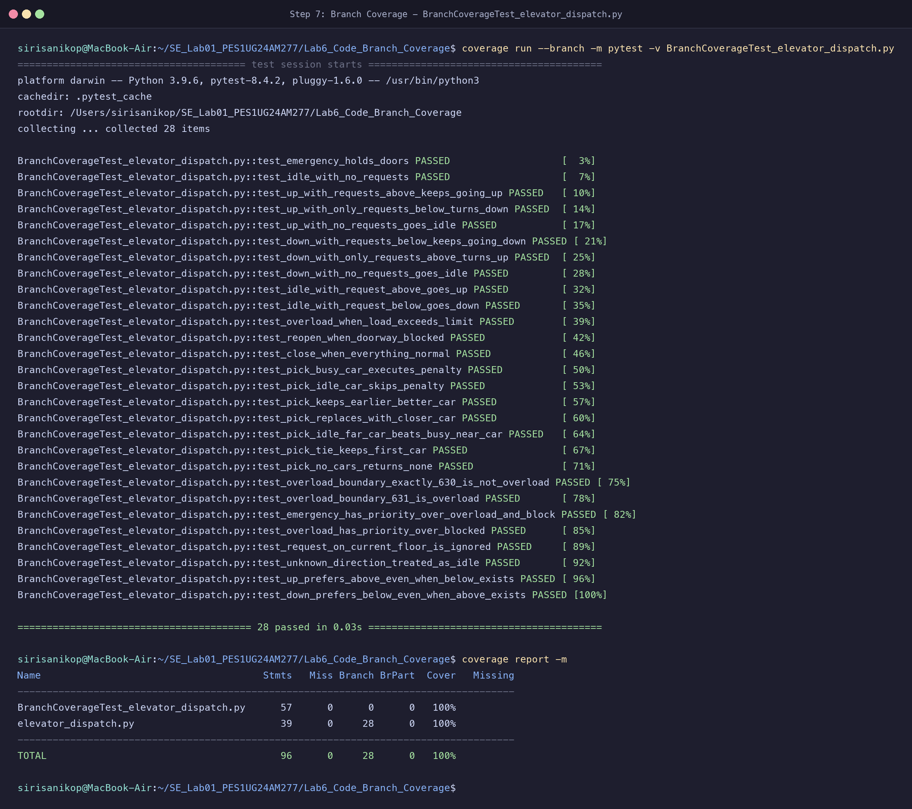

# Lab 6: Code and Branch Coverage Analysis

**Student:** Siri Sanikop  
**SRN:** PES1UG24AM277  
**Course:** Software Engineering Lab (UE24AM277)  
**Assigned Repository:** [SETAPESU26/L6_L7_38_elevator_dispatch](https://github.com/SETAPESU26/L6_L7_38_elevator_dispatch) (`lab6/`)  
**Assigned Domain:** Group 38 — Elevator Dispatching System  

---

## 1. Objective

- Understand the difference between **code (line) coverage** and **branch coverage**.
- Use Python's `coverage` tool with `pytest` to measure, analyse and improve test coverage.
- Identify untested paths and write targeted test cases for edge cases and decision branches.

## 2. Directory Structure

```text
Lab6_Code_Branch_Coverage/
├── README.md                                # This report
├── elevator_dispatch.py                     # Application under test (unchanged)
├── test_elevator_dispatch.py                # Original starter test file (2 tests)
├── CodeCoverageTest_elevator_dispatch.py    # Tests for >= 90% code (line) coverage
├── BranchCoverageTest_elevator_dispatch.py  # Tests for >= 90% branch coverage
└── screenshots/
    ├── step5_code_coverage.png              # Code coverage run + report (100%)
    └── step7_branch_coverage.png            # Branch coverage run + report (100%)
```

## 3. Module Under Test — `elevator_dispatch.py`

| Function | Purpose | Decisions |
|---|---|---|
| `next_direction(current, direction, requests)` | Chooses `up` / `down` / `idle` from pending floor requests | `direction == "up"`, `direction == "down"`, `if above`, `if below` (three blocks) |
| `door_action(load_kg, blocked, emergency)` | Decides door behaviour | `emergency`, `load_kg > 630`, `blocked` |
| `pick_elevator(cars, floor)` | Picks the car with the smallest gap (+5 penalty if busy) | `for` loop, `not is_idle`, `best is None or gap < best_gap` |

## 4. Commands Used

```bash
pip install coverage pytest

# Line (code) coverage
coverage run -m pytest -v CodeCoverageTest_elevator_dispatch.py
coverage report -m

# Branch coverage
coverage run --branch -m pytest -v BranchCoverageTest_elevator_dispatch.py
coverage report -m
```

## 5. Results Summary

Coverage figures below are for `elevator_dispatch.py` (39 statements, 28 branches).

| Stage | Test file | Tests | Line coverage | Branch coverage | Missing |
|---|---|---|---|---|---|
| Step 4 — Baseline | `test_elevator_dispatch.py` | 2 | 31% | 25% | lines 5-9, 11-15, 17, 19, 26-30, 34-43 |
| Step 5 — Code coverage | `CodeCoverageTest_elevator_dispatch.py` | 14 | **100%** | 97% | branches `38->40`, `40->36` |
| Step 7 — Branch coverage | `BranchCoverageTest_elevator_dispatch.py` | 28 | **100%** | **100%** | none |

### Step 4 — Baseline (starter tests)

The two starter tests only hit the emergency branch of `door_action` and the
"idle, no requests" path of `next_direction`. `pick_elevator` was never called.

```text
Name                   Stmts   Miss Branch BrPart  Cover   Missing
------------------------------------------------------------------
elevator_dispatch.py      39     27     28      5    25%   5-9, 11-15, 17, 19, 26-30, 34-43
```

### Step 5 — Code (line) coverage: 100%

`CodeCoverageTest_elevator_dispatch.py` adds one test per unreached `return`
statement (all 3 direction blocks × up/down/idle, overload / reopen / close),
plus a single **busy** car for `pick_elevator` so the `gap += 5` penalty line runs.



**Line coverage vs. branch coverage.** Every line now executes, yet running the
same file with `--branch` reports **97%** with two partial branches:

| Missing arc | Meaning | Why line coverage did not catch it |
|---|---|---|
| `38->40` | `if not is_idle:` evaluated **False** (an idle car) | The only car tested was busy, so the `if` body always ran |
| `40->36` | `if best is None or gap < best_gap:` evaluated **False** | With only one car, the first car always became `best` |

This is exactly the "false sense of security" the handout describes: 100% line
coverage, but two logical outcomes never tested.

### Step 7 — Branch coverage: 100%

`BranchCoverageTest_elevator_dispatch.py` keeps all code-coverage tests and adds:

- **`pick_elevator`**: idle car (no penalty), farther second car (best kept),
  closer second car (best replaced), busy-near vs idle-far car, tie (first wins),
  empty car list (loop never runs → `None`).
- **`door_action` boundaries & priority**: exactly 630 kg (not overload), 631 kg
  (overload), emergency beats overload + blocked, overload beats blocked.
- **`next_direction` edge cases**: request on the current floor is ignored,
  unknown direction behaves like idle, up/down prefer continuing in the same
  direction when requests exist on both sides.



## 6. Conclusion

- Starter tests: 31% line / 25% branch coverage.
- 14 targeted tests achieved **100% line coverage**, but branch analysis still
  exposed 2 untested decision outcomes in `pick_elevator`.
- 28 tests achieved **100% line and 100% branch coverage**, all passing.
- Branch coverage is the stronger criterion: it forces both outcomes of every
  decision to be exercised, which line coverage alone does not guarantee.
